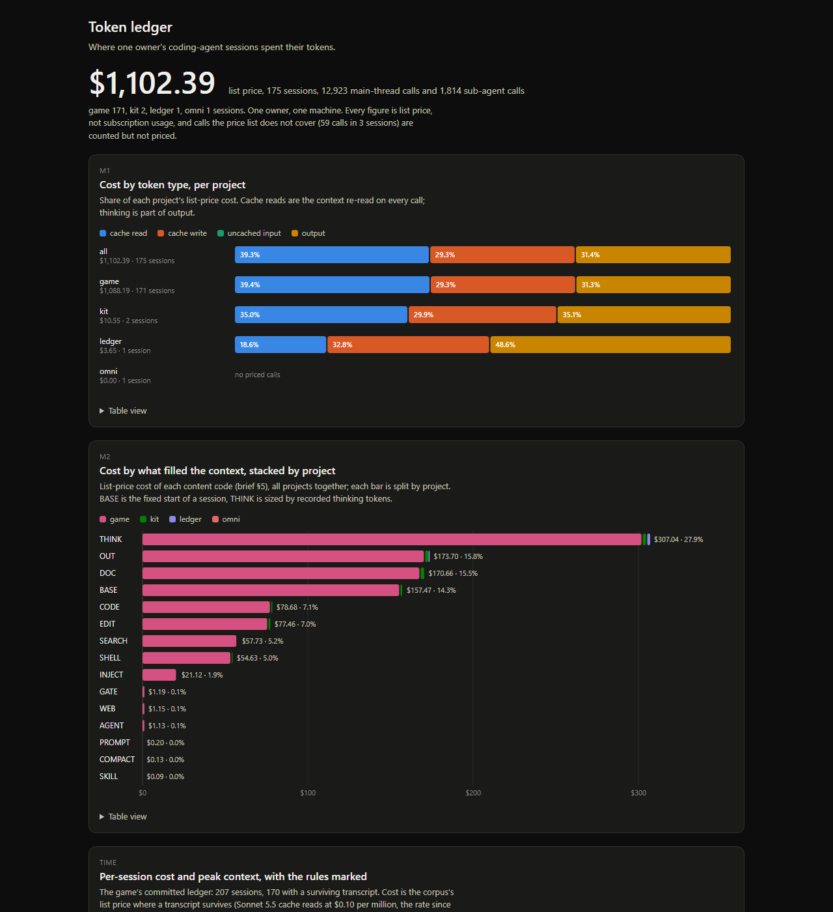

# Android's Agent Token Ledger

This repo is a case study of my own Claude Code sessions, with the code that measured them. The code reads Claude Code's session transcripts (the JSONL files it keeps under `~/.claude/projects/`), prices model calls at list price, and splits each priced call's cost two ways (see Terms). A static dashboard shows the result. It covers 175 sessions over four of my projects, 171 from a game I'm building. It answers my question: "Where do my coding-agent sessions spend their tokens, and which harness rules change that?" Claude Code sessions wrote the code under my direction, inside [my agent harness](https://github.com/AndroidTheHuman/androids-agentic-harness).

**[Open the dashboard](https://androidthehuman.github.io/androids-agent-token-ledger/dashboard/)** · [Findings](docs/research/FINDINGS.md) · [Metrics](docs/research/METRICS.md)



Panels: cost by token type and by content, each session's cost and peak context with the rules marked, the rule windows and routing, and this project's own sessions.

## Terms

- **Harness rules**: written rules my Claude Code sessions follow (`CLAUDE.md`, task briefs, skills, hooks). Three sets from the game's history:
  - **E1, session economy** (2026-10-02): a cost ledger, context-size warnings, one task per session, narrow reads, one test run per batch.
  - **E2, doc diet and part sizing** (2026-10-12 to 10-14): a smaller start read, real-token doc budgets, briefs sized by files they touch.
  - **E3, model routing** (2026-10-13): Sonnet for work that passed a trial.
- **Two cost splits.** By token type, as billed: uncached input, cache writes, cache reads, output (thinking included). By content, as classified: thinking, the model's own output, docs read, tool results, fixed start, the rest. Each adds to 100% alone: a doc re-read from cache is cache reads in one, docs read in the other.
- **Peak context**: a session's largest single-call context. **Re-read**: cache-read tokens summed over a session's calls, sub-agents included. **Fixed start**: the first call's context (tool definitions, system text, first messages).
- **Readings**: each answers one of eleven questions committed before the scan; passing its threshold triggers a decision set in advance, such as which rules to trial first. **Met**: the threshold was passed. **Associated** (a decision label, not proof of effect): median peak context or re-read per session fell ≥ 25% between fixed windows before and after a rule, with p < 0.05 (fewer than 5% of random regroupings of those sessions show a median fall at least as large).

## What it found

- Over 175 sessions, output (thinking included) is 31.4% of the cost by token type; cache reads are 39.3%, cache writes 29.3% and uncached input 0.0% (rounded: almost all input is cached). **Met**: output passed the 30% bar that puts effort and model rules first.
- By content, thinking (27.9%), the model's own output (15.8%) and docs read (15.5%) together pass half the cost. **Met**: they are the first targets. Transcripts hold little or no thinking text, so thinking's 27.9% is its billed output plus its cost as later context, sized from recorded thinking tokens and assuming it stays in the context. The token-type split, peak context and re-read don't rest on that assumption.
- After E1, median peak context per session fell from 470k to 247k tokens, and re-read from 27.2M to 6.7M (17 sessions before, 19 after; p ≤ 0.001). **Associated**; the same rules also split work into smaller sessions.
- After E2, median peak context, re-read and fixed start per session rose 19.8%, 39.6% and 8.5% (32 / 31 sessions; fixed start 28 / 31: it needs a transcript). **Not associated**: none fell. The register tested for falls only, so the rises are reported, not tested.
- E3 was priced, not compared over windows: at Opus rates, the 43 of 208 game sessions that ran calls off Opus would have cost more by 12.8% of the game's total (the 208 include 37 known only from the game's own ledger, their transcripts gone). **Met** (≥ 10%): routing is worth more trials.

## What it means

For someone running coding agents, the findings rank where to trial rules first: thinking (the effort setting per kind of work, and session length), model routing, the model's own output, then the start read. They don't show that any such rule saves money, only where the cost is and so where a trial should start.

## How it was built

- The eleven questions and their decision thresholds were committed before any transcript was scanned ([the register](docs/research/FINDINGS.md#the-question-register)).
- A blind second coder, an Opus sub-agent, coded 180 sampled pieces of context without seeing the classifier's codes, and agreed with the classifier at Cohen's κ 0.970 ([HANDREAD](docs/research/HANDREAD.md)).
- Codex, from another provider, checked the findings and this page against the repo ([OUTSIDE_REVIEW](docs/research/OUTSIDE_REVIEW.md)).
- The ledger measured its own build: 14 sessions up to this page, 2026-11-09 to 2026-11-11 ([SESSION_LEDGER](docs/SESSION_LEDGER.md), panel 5).

## Limits

- One owner, one main project (the game: 171 of 175 sessions): observations, not effects.
- List price, not subscription usage.
- The transcript format is undocumented: a Claude Code update can break a measure silently.
- The code is wired to these four projects and the game's repo, so the study reruns only on my machine (see Run it).

## Run it

### On a clone

Node 22.18 or later. Run `npm install` once.

```bash
npm run check                                  # the gate: typecheck + tests
npm run ledger -- dashboard                    # rebuild dashboard/data.js from the committed JSON
npm run ledger -- agree                        # re-score the classifier against the committed hand codes -> docs/research/HANDREAD.md
```

Both rebuilds reproduce the committed files. Open `dashboard/index.html` straight from disk: it needs no server and no network.

### Reproducing the study

These commands read Claude Code's transcripts under `~/.claude/projects/`, their git-ignored copies in `data/private/`, and the game's repo, so they run only on my machine.

```bash
npm run sessions                               # this repo's session ledger -> docs/SESSION_LEDGER.md
npm run sessions -- --current                  # the newest session's row

npm run ledger -- scan --before=<ISO>          # find transcripts, write MANIFEST.json and the git-ignored caches
npm run ledger -- game-ledger                  # the game's committed ledger and the rule timeline (git show, read-only)
npm run ledger -- report                       # attribute cost; write data/corpus/*.json and docs/research/METRICS.md
npm run ledger -- check                        # recount MANIFEST, re-parse against tools/sessions.ts; print the last report's identity and game-ledger checks
npm run ledger -- sample                       # the hand read's sample (text goes to data/private/, git-ignored)
```

`--before` is the start time printed by `npm run sessions -- --current`, so the session that runs the scan is not in its own corpus. After `npm run sessions` adds a row, run `dashboard` again so panel 5 shows it.

## What is committed, and what is not

Committed: numbers, ids, timestamps, content codes, tool names and project labels. The project's rule is that no transcript text is committed. `tests/privacy.test.ts` checks every string in each committed JSON under `data/` and `dashboard/`, and in `dashboard/data.js`: each must be one token (an id, a code, a tool name) or a known derived label, so no sentence passes. Before release, a privacy pass found no transcript file in any commit ([PRIVACY](docs/PRIVACY.md)). Everything that holds text (the raw transcript copy, the merged copy, the per-unit cache, the hand read's sample) lives in `data/private/`, which `.gitignore` excludes. What a clone can run is under "Run it".

## License

MIT, see [LICENSE](LICENSE).
